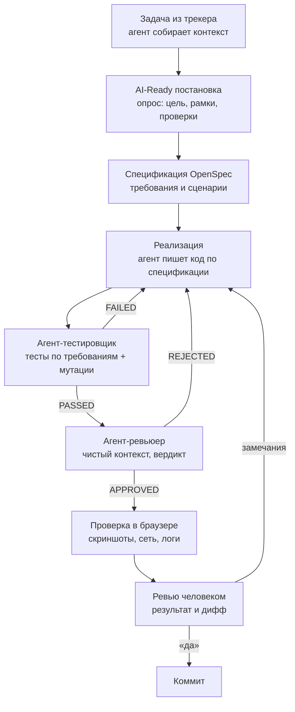

# ai-dev-workflow

Процесс фронтенд-разработки с ИИ-агентами (Claude Code), который я выстроил и использую в продакшн-проекте: B2B SaaS-платформа, монорепозиторий на React и TypeScript.

Здесь только схема и описание процесса. Определения агентов, правила и шаблоны задач лежат в закрытом репозитории: могу показать и разобрать на собеседовании.

**Главный принцип:** агенты пишут код и тесты, но в репозиторий ничего не попадает без проверки и явного «да» человека.

## Схема

## Как это работает

1. **Постановка.** Агент читает тикет и связанные страницы, собирает контекст кода и готовит черновик задачи в едином формате: что сделать, проверяемый результат, рамки, что вне задачи, какие проверки обязательны. Баг сначала воспроизводится по шагам. Дальше короткий опрос, пока понимание не станет общим.
2. **Спецификация.** Фича оформляется как [OpenSpec](https://github.com/Fission-AI/OpenSpec) change: требования, сценарии, решения с датой и причиной. По этим требованиям потом судят тестер и ревьюер.
3. **Реализация** по спецификации.
4. **Тестер.** Отдельный агент пишет тесты по требованиям, а не по коду, и проверяет каждый новый тест мутацией: ломаем строку продукта, тест должен упасть.
5. **Ревьюер.** Отдельный агент со свежим контекстом, без истории автора кода. Гоняет проверки, выносит вердикт по каждому сценарию и проходит чек-лист типичных пропусков.
6. **Живая проверка** в браузере: шаги, скриншоты, запросы в сети.
7. **Ревью человеком и коммит.** Коммит только после явного «да».

## Принципы

- **Агент себя не оценивает.** Тесты и ревью делают независимые агенты со свежим контекстом.
- **Требования живут в спецификации,** а не в переписке и черновиках.
- **Факты — из данных.** Механизм, выведенный из чтения кода, считается гипотезой, пока его не подтвердили сеть, логи или состояние приложения.
- **Модель под задачу.** Сбор контекста и анализ делает более дешёвая модель, код, тесты и ревью — сильная.
- **Ошибки становятся правилами.** Каждый пропущенный дефект превращается в правило с датой и причиной, и ревьюер проверяет по ним дифф.

## Результат

- Крупную бизнес-задачу закрываю примерно за 2 дня: 5–6 задач за спринт против одной до внедрения процесса.
- На пробном запуске агент-ревьюер нашёл 4 реальных дефекта.

---

Анатолий Метелица, Frontend Team Lead
